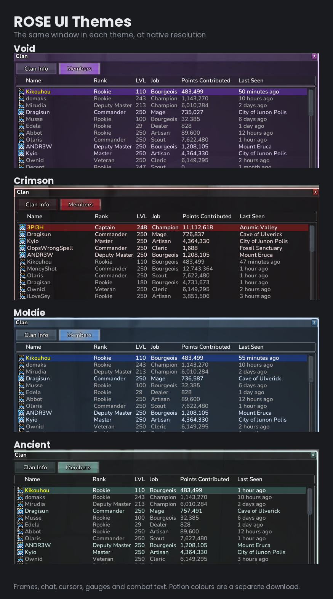
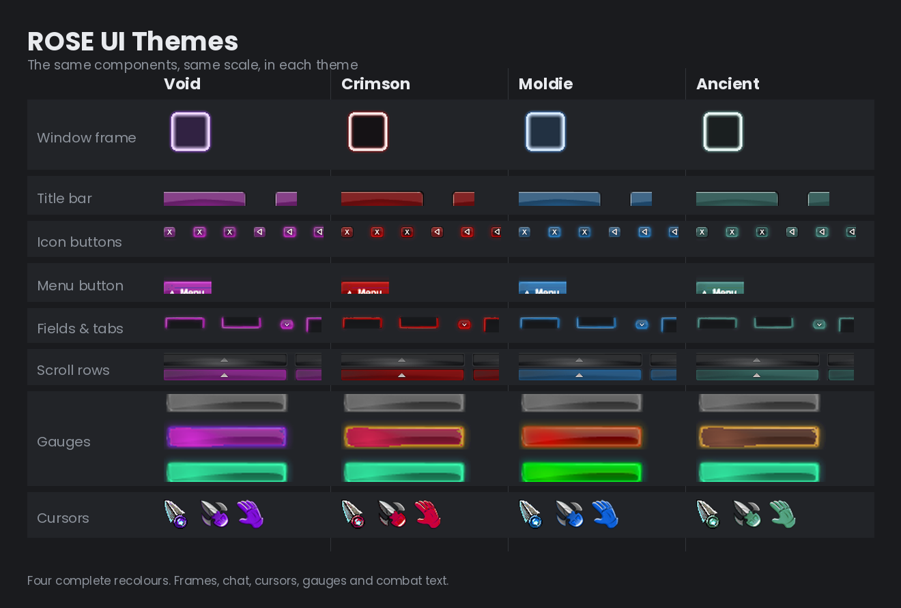
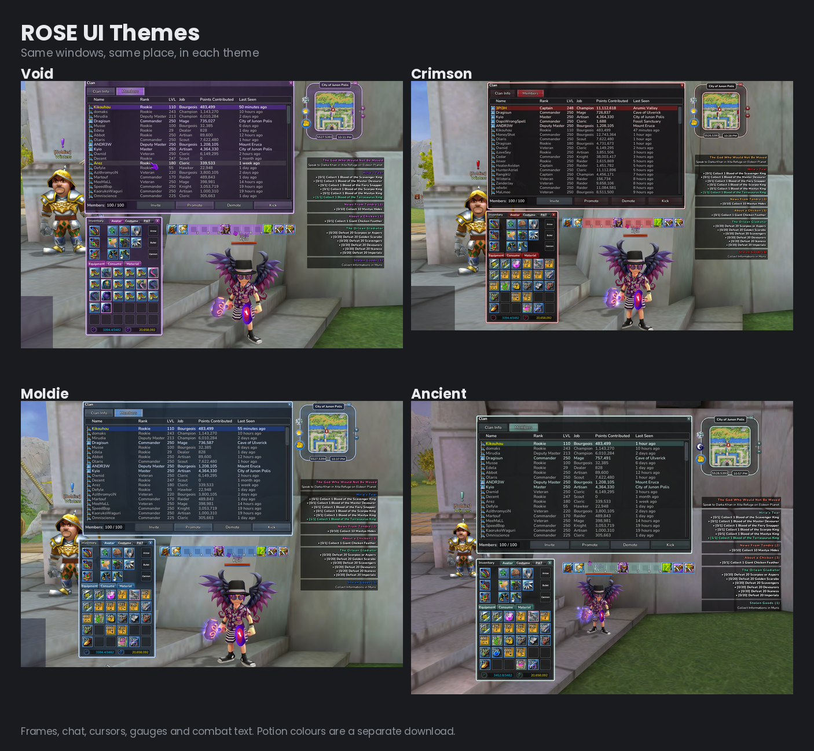

# UI Themes

Four complete interface recolors — window frames, buttons, tabs, chat box, minimap ring,
cursors, gauges, and combat text.

| Theme | Look |
|---|---|
| **Void** | purple and violet chrome, magenta clan accent — the original |
| **Crimson** | near-black glass, deep blood-red glow, bone-white rim, amber alerts |
| **Moldie** | royal blue chrome, hat-gold highlights |
| **Ancient** | slate verdigris chrome, copper highlights, clay and steel gauges |

Component breakdown, and all four in game

**Download:**
[Void](../../releases/latest/download/ROSE_UI_Void.zip) ·
[Crimson](../../releases/latest/download/ROSE_UI_Crimson.zip) ·
[Moldie](../../releases/latest/download/ROSE_UI_Moldie.zip) ·
[Ancient](../../releases/latest/download/ROSE_UI_Ancient.zip)

**Updated for the 16 October 2026 patch.** The new minimap frame, the chat settings button,
the party controls and the group manager button are all themed, and every color and tweak the
themes had before is kept. Coming from an older version? Delete one leftover file first —
[see installing](installing.md#updating-a-ui-theme-from-before-16-october-2026).

**Want your own colors?** [ROSE UI Editor](https://github.com/OlarisMods/ROSE_UI_Editor) builds
a complete theme from any two colors, or a random matched pair — with undo.

Potion colors are **not** included in the theme packs — they are
[their own thing](potion-beams.md), so you can mix and match rather than having a
color forced on you.
